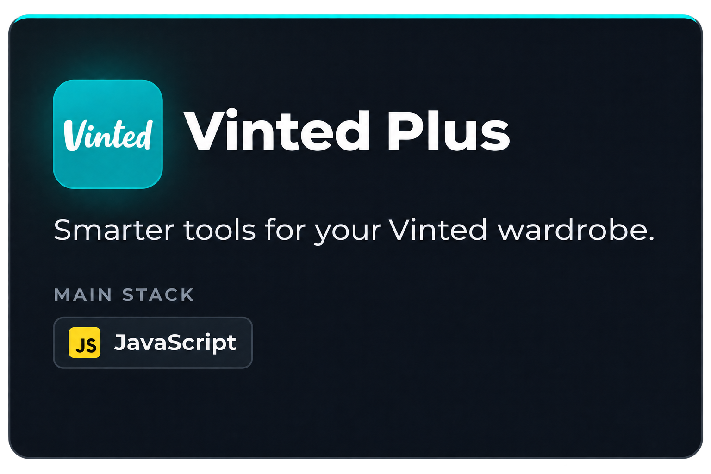
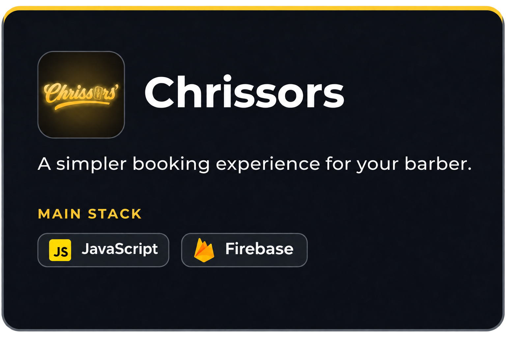
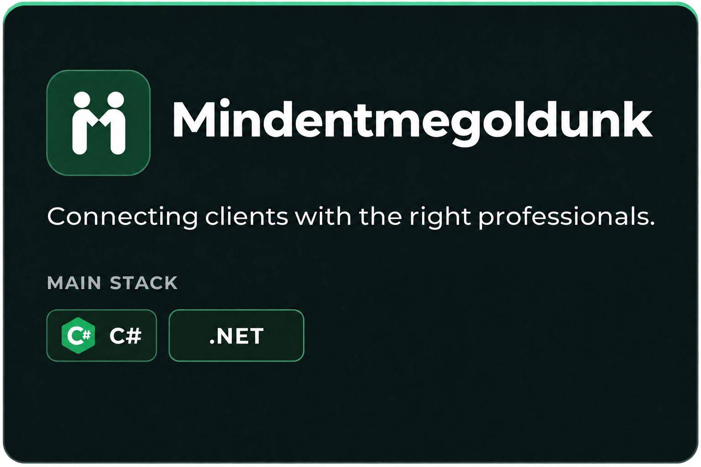

# Hi, I'm Balázs 👋

I'm a Computer Science student based in Hungary.
I enjoy turning ideas into useful web apps, browser extensions, and practical tools.

My projects range from making Vinted wardrobe management easier to simplifying
barber appointments and connecting clients with professionals.

### Tech stack

### Let's connect

[LinkedIn](https://www.linkedin.com/in/balazsfabian/)

### Projects I've worked on

  
  
  

